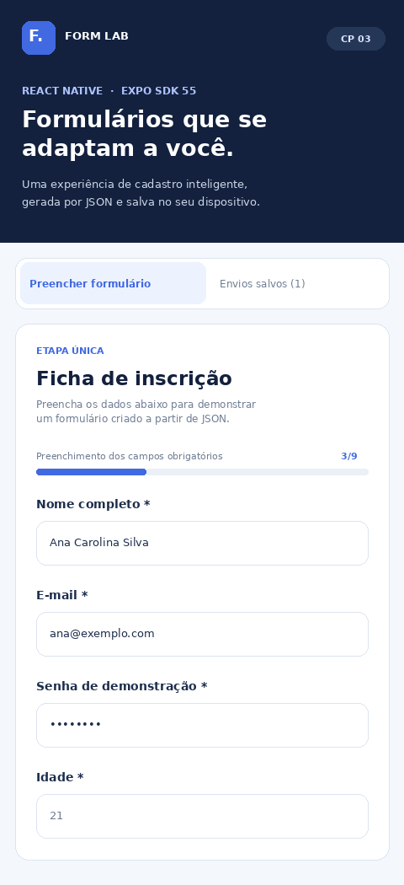
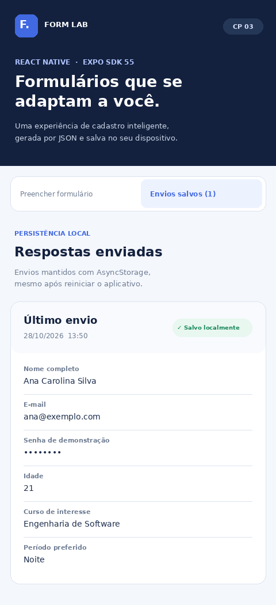

# AVISO DE COMPATIBILIDADE

**Este projeto utiliza Expo SDK 58**, preparado para o Expo Go SDK 58 informado no celular.

**A atividade do professor exige Expo SDK 55**. Esta edição SDK 58 é destinada a testes no Expo Go instalado e **não cumpre o requisito de versão para entrega oficial**. Para entregar a atividade sem perder a exigência de versão, utilize a versão SDK 55 do projeto e instale o Expo Go correspondente em um dispositivo Android ou emulador, ou teste com uma development build compatível.

**Instalação:** extraia a pasta, abra no VS Code e rode `npm install`, `npx expo install --fix` e `npx expo start -c`. Precisa de Node.js 22.13 ou superior compatível.

**Limitação desta edição:** foi conferida a estrutura e foram executados os testes de lógica, mas não foi possível baixar dependências npm neste ambiente, então a execução completa no Expo Go SDK 58 precisa ser confirmada no seu dispositivo.

---

# Form Lab — Checkpoint 3: Formulário Dinâmico

Aplicação acadêmica em **React Native + Expo SDK 58 + TypeScript** que monta um formulário a partir de uma configuração **JSON**, valida as respostas, mostra os envios e os armazena localmente com **AsyncStorage**.

> **Entrega:** publicar este projeto em um repositório no **GitHub** e enviar **somente o link do repositório** pelo canal indicado pelo professor. O arquivo ZIP serve apenas para transferir os arquivos para sua máquina; não substitui a entrega no GitHub.

## Prévia da interface

As imagens abaixo são **pré-visualizações ilustrativas** do layout, e **não capturas executadas do aplicativo**. **Antes da entrega, substitua pelas suas próprias capturas reais** no Android, iOS ou Web para cumprir integralmente o item “prints da aplicação”.

| Formulário | Resultado persistido |
| --- | --- |
|  |  |

## Funcionalidades implementadas

- Os campos são criados usando `formConfig.fields.map(...)`, a partir de `src/config/formulario.json`.
- Os **10 tipos obrigatórios** funcionam: `text`, `email`, `password`, `number`, `multiline`, `select`, `radio`, `checkbox`, `switch` e `date`.
- Também há suporte aos aliases `textarea` e `combo`.
- Os campos `select` e `radio` recebem as opções diretamente de `options` no JSON.
- Todos os campos são controlados com `useState`, com validações por tipo e mensagem junto ao campo.
- **Checkbox** obrigatório só é válido quando marcado. **Switch** aceita tanto `true` quanto `false` como respostas válidas.
- **Data** é digitada no formato `DD/MM/AAAA`, com máscara e validação de calendário (incluindo anos bissextos). A entrada funciona igualmente em Android, iOS e Web sem componente específico por plataforma.
- Envio válido abre a aba **Envios salvos**, com as respostas identificadas por campo e data/hora do envio.
- Os últimos 20 envios são mantidos em AsyncStorage e recuperados ao reabrir o aplicativo.
- O botão **Apagar todos** remove os envios do AsyncStorage e atualiza a interface.
- Progresso dos campos obrigatórios calculado com `useMemo`.
- Também são usados efetivamente `useEffect` e `useCallback`.
- Componentes `Pressable`, `Switch`, `TextInput`, `ScrollView`, Flexbox e `StyleSheet` de React Native.

**Privacidade:** o AsyncStorage não é criptografado. Por isso, o campo de senha é apenas demonstrativo e o valor é substituído por pontos antes da persistência. **Não use senhas reais nesse projeto.**

## Tecnologias

- React Native 0.88.0
- Expo SDK 58 (`expo ~58.0.0`)
- React 19.3.0
- TypeScript
- `@react-native-async-storage/async-storage` 2.2.0
- React Native Web 0.21 e `@expo/metro-runtime` 58 (suporte à Web)

## Como executar

**Requisitos:** Node.js 22.13+ (recomendado Node.js 22 LTS ou superior compatível), npm, acesso à internet na primeira instalação, e um ambiente Android/iOS ou um navegador para Web.

```bash
npm install
npx expo install --fix
npm run typecheck
npm test
npx expo start
```

No terminal do Expo, pressione **`w`** para abrir no navegador. Alternativamente, use:

```bash
npm run web
npm run android
npm run ios
```

Também é possível abrir em um dispositivo físico com uma versão do Expo Go compatível com o **SDK 58** ou com um development build. Verifique a compatibilidade instalada antes de escanear o QR Code.

### Como verificar todos os critérios

1. Abra **Preencher formulário** e tente enviar tudo em branco: aparecem as mensagens de erro.
2. Digite e-mail inválido, número com letras e data como `31/02/2026`: o aplicativo bloqueia o envio.
3. Preencha os campos obrigatórios, selecione um curso e um período e marque o checkbox.
4. Deixe o switch desligado: isso **não** impede o envio válido.
5. Envie e confira a aba **Envios salvos** e o rótulo de cada resposta.
6. Feche e reabra a aplicação: o histórico deverá continuar disponível.
7. Toque em **Apagar todos** e verifique que as respostas desapareceram.
8. Altere/adapte o JSON em `src/config/formulario.json`: os campos e rótulos são gerados sem editar `App.tsx` ou `DynamicField.tsx`.

**Importante:** para mudanças na lista de campos enquanto o aplicativo está aberto, reinicie a sessão; o carregamento é feito a partir de um JSON local incluído no bundle.

## Estrutura de pastas

```text
checkpoint-3-formulario-dinamico/
├── App.tsx
├── app.json
├── index.ts
├── package.json
├── tsconfig.json
├── tsconfig.tests.json
├── README.md
├── tests/
│   └── validation.test.cjs
├── assets/screenshots/
│   ├── previa-formulario.png
│   └── previa-resultados.png
└── src/
    ├── components/
    │   ├── DynamicField.tsx
    │   └── SubmissionCard.tsx
    ├── config/
    │   ├── formulario.json
    │   └── index.ts
    ├── hooks/
    │   ├── useDynamicForm.ts
    │   └── usePersistedSubmissions.ts
    ├── services/
    │   └── storage.ts
    ├── theme/
    │   └── colors.ts
    ├── types/
    │   └── form.ts
    └── utils/
        ├── format.ts
        ├── validation.ts
        └── submissions.ts
```

## Como adaptar o JSON

O arquivo `src/config/formulario.json` é a fonte da tela. Um campo deve possuir ao menos `id`, `label` e `type`. `required`, `placeholder`, `helpText` e `options` são propriedades adicionais. Exemplo:

```json
{
  "id": "favoriteColor",
  "label": "Cor favorita",
  "type": "select",
  "required": true,
  "options": [
    { "label": "Azul", "value": "blue" },
    { "label": "Verde", "value": "green" }
  ]
}
```

Adicione esse objeto ao array `fields` e a nova entrada será exibida automaticamente.

## Testes

`npm test` executa testes automatizados para campos obrigatórios, e-mail e número, checkbox/switch, opções de select/radio, máscara e validade das datas, ocultação de senha e recuperação de dados válidos do armazenamento. Para confirmar a compatibilidade de **Android, iOS e Web**, também é necessário **rodar o aplicativo nas três plataformas** — testes unitários não substituem esse procedimento.

## Integrantes

- **Musashi Mabuti** — **RM559444**
- **Felipe Gimenes** — **RM99799**

## Referências

- [Enunciado do professor](https://github.com/anderltda/doc-react-native/blob/main/CPS/3ESPS/Primeiro%20Semestre/README_TRABALHO_REACT_NATIVE_FORMULARIO_DINAMICO_APP.md)
- [Documentação do Expo SDK 58](https://docs.expo.dev/versions/v58.0.0/)
- [AsyncStorage para Expo SDK 58](https://docs.expo.dev/versions/v58.0.0/sdk/async-storage/)
